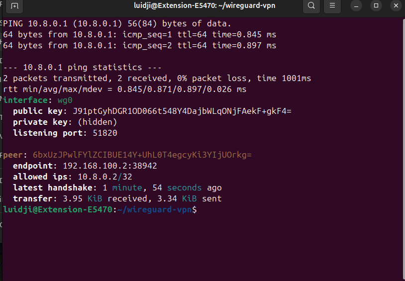
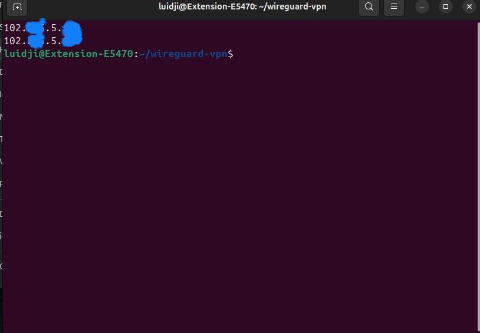
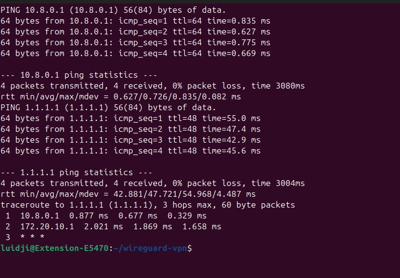

# Serveur VPN WireGuard

Deploiement d'un serveur VPN WireGuard sur Ubuntu, teste avec un client, avec scripts d'installation et de gestion des clients.

## Architecture

    Client (wgc 10.8.0.2)  <== tunnel chiffre UDP 51820 ==>  Serveur (wg0 10.8.0.1) --NAT--> Internet

Details : [docs/architecture.md](docs/architecture.md)

## Contenu du depot

| Dossier        | Role |
|----------------|------|
| scripts/       | install-wireguard.sh, add-client.sh, revoke-client.sh |
| configs/       | Modeles .conf.example (cles remplacees par des placeholders) |
| docs/          | Architecture, installation serveur, configuration client, tests |
| screenshots/   | Preuves : wg show, curl ifconfig.me, ping et traceroute |

## Quick start

Sur le serveur (Debian ou Ubuntu) :

    git clone https://github.com/Luidji-artemis/wireguard-vpn
    cd wireguard-vpn
    sudo ./scripts/install-wireguard.sh
    sudo ./scripts/add-client.sh client1 <IP_SERVEUR>
    sudo wg show

Le fichier /etc/wireguard/clients/client1.conf est a importer dans le client (QR code possible avec QR=1). Revocation :

    sudo ./scripts/revoke-client.sh client1

Documentation :

- [Installation du serveur](docs/installation-serveur.md)
- [Configuration du client](docs/configuration-client.md)
- [Tests et preuves](docs/tests.md)

## Preuves

## Securite

- Les cles privees ne sont jamais versionnees : le .gitignore bloque *.key, *.conf et le dossier clients/. Seuls les fichiers .conf.example sont publies.
- Les cles et fichiers de configuration sont crees avec des droits 600, lisibles par root uniquement.
- Une cle privee affichee ou envoyee quelque part doit etre consideree comme compromise : la regenerer.
- Seul le port UDP 51820 est ouvert.
- Chaque client a sa propre paire de cles et peut etre revoque individuellement.
- Limite du test : le client est simule sur la meme machine que le serveur, donc l'IP publique ne change pas. Voir docs/tests.md.

## Licence

MIT, voir [LICENSE](LICENSE).
